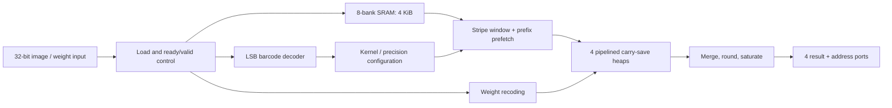
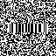

# Barcode-Configured Convolution Accelerator

A four-lane Verilog image filtering accelerator that reads its kernel configuration
from a barcode embedded in the image itself. It combines a streaming LSB barcode
detector, eight-bank SRAM storage and pipelined signed-digit arithmetic to process
64 × 64 grayscale images with 3 × 3, 4 × 4 or 5 × 5 kernels and 4-bit or 8-bit weights.

這個專案將影像 LSB 條碼解碼、SRAM 分銀行存取與四路固定小數點運算整合在同一個硬體核心。
設計保留提交版本，並提供官方 testbench、設計說明、可重現測試與分清證據來源的效能紀錄。

Developed for **NTU Computer-Aided VLSI System Design, Fall 2026, Homework 3**.
The exact RTL from `cvsd_hw3_v3.tar` is preserved; course materials and portfolio
additions are identified in [provenance](docs/PROVENANCE.md).

## Design highlights

- **Decode while loading.** A 46-bit barcode window recognizes all six supported
  K/W configurations. Nineteen rotating records validate ten consecutive identical
  rows without storing a separate LSB image.
- **Eight-bank image store.** Eight 512 × 8 SRAMs hold the complete 4 KiB image.
  Banking by `x mod 8` supplies eight neighboring columns per read for four
  adjacent output pixels.
- **Stripe traversal and prefetch.** A shared 5 × 8 window reuses four retained
  rows, with prefix storage bridging four-column stripes and startup prefetch
  overlapping configuration/weight reception.
- **Fused arithmetic.** Load-time radix-4 signed-digit recoding feeds four
  carry-save compression heaps. Five heap register boundaries, a carry-save
  merge and a split final adder shorten the arithmetic paths.
- **Precision-aware reuse.** W4 modes and 3 × 3/W8 issue four pixels per
  steady-state cycle. The 3 × 3/W8 mode packs both coefficient components into
  spare tap slots; larger W8 kernels reuse the heap over two cycles.
- **Bit-exact output processing.** Full-range 21-bit accumulation, zero padding,
  final rounding and saturation to 8-bit grayscale; four addressed result ports
  allow stripe-order output.



The operation follows the supplied golden files' unflipped-kernel
cross-correlation convention. [Architecture](docs/ARCHITECTURE.md) explains
the memory mapping, arithmetic and mode scheduling.

## Performance and validation

**Fresh public RTL regression: 7/7 PASS at a simulated 2.28 ns period.**
Each of the six legal configurations compares all 4096 outputs: **24,576 pixel
comparisons**, plus invalid-configuration rejection in TB0. The repository's
functional SRAM model reproduces the archived cycle counts below.

| Pattern | Kernel / weight precision | Execution cycles | Time at 2.28 ns |
| --- | --- | ---: | ---: |
| TB1 | 3 × 3 / W4 | 1,041 | 2,373.48 ns |
| TB2 | 3 × 3 / W8 | 1,041 | 2,373.48 ns |
| TB3 | 4 × 4 / W4 | 1,042 | 2,375.76 ns |
| TB4 | 4 × 4 / W8 | 2,066 | 4,710.48 ns |
| TB5 | 5 × 5 / W4 | 1,045 | 2,382.60 ns |
| TB6 | 5 × 5 / W8 | 2,069 | 4,717.32 ns |

Execution cycles use the official testbench's interval, excluding image loading;
these are complete execution counts, not just steady-state compute cycles.

The archived [submission report](report.txt) records **571,937.564082 µm²** area
and a **2.28 ns** clock. Area remains a submission-reported value: matching raw
area/STA/GLS reports were not supplied with this archive. The synthesis SDC
requests **2.36 ns**. RTL simulation at 2.28 ns establishes functional cycles,
while physical timing closure and timed GLS remain unverified here.
See [performance and evidence](docs/PERFORMANCE.md) for the course metric,
retained logs, source hashes and verification scope.

## Run the tests

Requires Python 3.6+ and an installed, licensed Synopsys VCS environment.
The included independent SRAM model provides functional RTL behavior; proprietary
macro and standard-cell libraries are external dependencies.

```bash
git clone https://github.com/sam710026/barcode-convolution-accelerator.git
cd barcode-convolution-accelerator
python3 scripts/check_project.py
module load vcs/2025.06  # when available in your environment
python3 scripts/run_tests.py
```

Run a single case, change the simulated period, or use your own licensed macro
model without copying it into this repository:

```bash
python3 scripts/run_tests.py --cases tb6 --period 2.28
python3 scripts/run_tests.py --sram-model /path/to/licensed/sram_512x8.v
```

Each invocation creates a new ignored `.build/` directory containing full
compile/simulation logs and `summary.json`. The runner checks PASS/error banners,
4096 result writes per valid image, process failures, timeouts and source hashes.
[Test scope](tests/README.md) describes what this regression covers.

## Example input

Course-provided TB5 image and its LSB plane, which carries the configuration barcode:

| Input image | LSB plane |
| --- | --- |
|  |  |

## Repository layout

| Path | Contents |
| --- | --- |
| [01_RTL/](01_RTL/) | Exact submitted assembled `core.v` and original filelist |
| [02_SYN/](02_SYN/) | Original Design Compiler script, constraints and source list |
| [03_GATE/](03_GATE/) | Original gate-level filelist; requires external libraries and netlist |
| [00_TESTBED/](00_TESTBED/) | Unmodified official testbench, patterns and image illustrations |
| [sim/](sim/) | Independent functional SRAM model for public RTL reproduction |
| [scripts/](scripts/) | Source/package checks and isolated VCS regression runner |
| [docs/spec/](docs/spec/) | Assignment specification and TA notes |
| [docs/evidence/](docs/evidence/) | Retained release test logs and source identities |

Original filelists retain the course's relative paths; `scripts/run_tests.py`
selects the public model explicitly. The synthesis script requires the licensed
TSMC13/Artisan SRAM libraries and `ADDFX1` / `DFFHQX8` cells. Its original course
paths and knobs are preserved. Heap-generator/assembly scripts mentioned by RTL
comments were absent from the requested archive; the assembled RTL is complete.

Course specifications, testbench and patterns retain their original attribution.
No repository-wide license is assigned to those materials.
